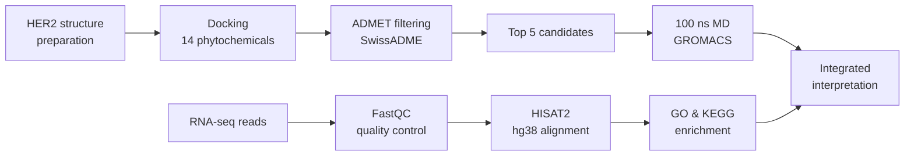

<div align="center">

# 🧬 HER2 Computational Oncology Portfolio


**An integrated in-silico pipeline for discovering HER2-targeting phytochemicals in breast cancer: from docking to dynamics to transcriptomics.**

[Overview](#-overview) • [Key Features](#-key-features) • [Tech Stack](#️-tech-stack) • [Workflow](#-workflow) • [Results](#-results) • [Project Structure](#-project-structure) • [Getting Started](#-getting-started) • [Roadmap](#️-roadmap) • [Author](#-author)

[](https://pyrx.sourceforge.io)
[](http://www.swissadme.ch)
[](https://www.gromacs.org)
[](https://usegalaxy.org)
[](https://daehwankimlab.github.io/hisat2/)
[](https://www.python.org)

</div>

---

## 🎯 Overview

HER2 (ERBB2) is overexpressed in roughly 20% of breast cancers and drives an aggressive disease subtype. This project combines **structure-based drug discovery** with **transcriptomic analysis** to identify and evaluate plant-derived compounds that may inhibit HER2.

The work was carried out during my bioinformatics internship at **BioNome** (May – Aug 2026).

> [!NOTE]
> All analyses in this repository are computational (in silico). Experimental validation would be required to confirm any candidate's activity.

<p align="right"><a href="#-her2-computational-oncology-portfolio">⬆ Back to top</a></p>

---

## ✨ Key Features

<details open>
<summary><b>💊 Drug Discovery (click to expand/collapse)</b></summary>
<br/>

- **Molecular Docking**: virtual screening of 14 phytochemicals against HER2 using PyRx
- **ADMET Profiling**: drug-likeness and pharmacokinetics evaluated with SwissADME
- **Shortlisting**: top 5 candidates selected on binding affinity and ADMET properties
- **Molecular Dynamics**: 100 ns GROMACS simulation of the HER2–ligand complex to assess stability

</details>

<details>
<summary><b>🧪 Transcriptomics (click to expand)</b></summary>
<br/>

- **Quality Control**: FastQC assessment across 9 quality metrics
- **Alignment**: reads mapped to the human reference genome (hg38) with HISAT2
- **Functional Enrichment**: GO and KEGG pathway analysis

</details>

<p align="right"><a href="#-her2-computational-oncology-portfolio">⬆ Back to top</a></p>

---

## 🛠️ Tech Stack

| Category | Tools |
|---|---|
| **Docking** | PyRx (AutoDock Vina) |
| **ADMET** | SwissADME |
| **Molecular Dynamics** | GROMACS |
| **RNA-seq** | Galaxy, FastQC, HISAT2 |
| **Enrichment** | GO, KEGG |
| **Languages** | Python, R |

<p align="right"><a href="#-her2-computational-oncology-portfolio">⬆ Back to top</a></p>

---

## 🔄 Workflow



<p align="right"><a href="#-her2-computational-oncology-portfolio">⬆ Back to top</a></p>

---

## 📊 Results

<div align="center">

| Metric | Value |
|:---:|:---:|
| Compounds screened | **14** |
| Shortlisted candidates | **5** |
| Best binding affinity | **−7.7 kcal/mol** |
| MD simulation length | **100 ns** |
| Reference genome | **hg38** |

</div>

<!-- Upload your figures to a "results" folder and keep the file names below the same, or change them to match. -->

<details open>
<summary><b>🖼️ Figures (click to expand/collapse)</b></summary>
<br/>

<p align="center">
  
  
</p>
<p align="center">
  
  
</p>

</details>

> [!TIP]
> Start with the `results/` folder for a quick look at the key findings.

<p align="right"><a href="#-her2-computational-oncology-portfolio">⬆ Back to top</a></p>

---

## 📁 Project Structure

<!-- Edit the folder names below to match the folders actually in this repo. -->

<details>
<summary><b>📂 View folder layout (click to expand)</b></summary>
<br/>

```
HER2-Computational-Oncology-Portfolio-Updated/
├── docking/          # Ligand files, PyRx outputs, binding scores
├── admet/            # SwissADME results
├── md_simulation/    # GROMACS inputs and analysis plots
├── rna_seq/          # FastQC reports, alignment stats, enrichment results
├── results/          # Final figures and tables
└── README.md
```

</details>

<p align="right"><a href="#-her2-computational-oncology-portfolio">⬆ Back to top</a></p>

---

## 🚀 Getting Started

```bash
# Clone the repository
git clone https://github.com/waihida0406/HER2-Computational-Oncology-Portfolio-Updated.git
cd HER2-Computational-Oncology-Portfolio-Updated
```

**Requirements:** PyRx · GROMACS · access to a Galaxy server · Python 3

<p align="right"><a href="#-her2-computational-oncology-portfolio">⬆ Back to top</a></p>

---

## 🗺️ Roadmap

<!-- Add only the next steps you actually plan, as unticked "- [ ]" lines. -->

- [x] Molecular docking of 14 phytochemicals
- [x] ADMET profiling and shortlisting of 5 candidates
- [x] 100 ns molecular dynamics simulation
- [x] RNA-seq alignment and GO/KEGG enrichment

<p align="right"><a href="#-her2-computational-oncology-portfolio">⬆ Back to top</a></p>

---

## 👩‍🔬 Author

<div align="center">

**Waihida Yashmin**
MSc Biotechnology · SRM Institute of Science and Technology, Chennai

[](https://linkedin.com/in/waihida-yashmin-3467bb230)
[](https://github.com/waihida0406)

⭐ *If you find this project useful, consider giving it a star!*

</div>

